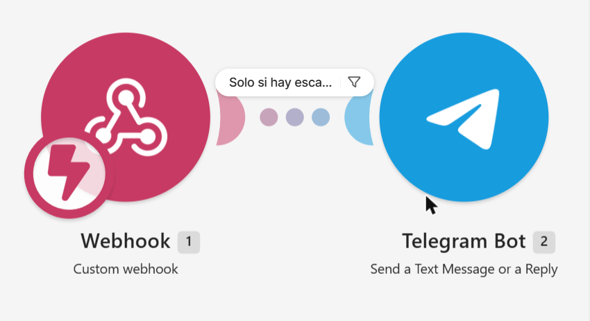
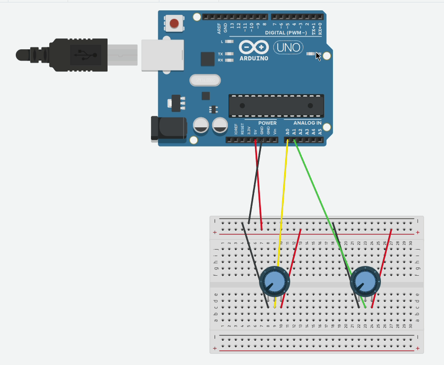
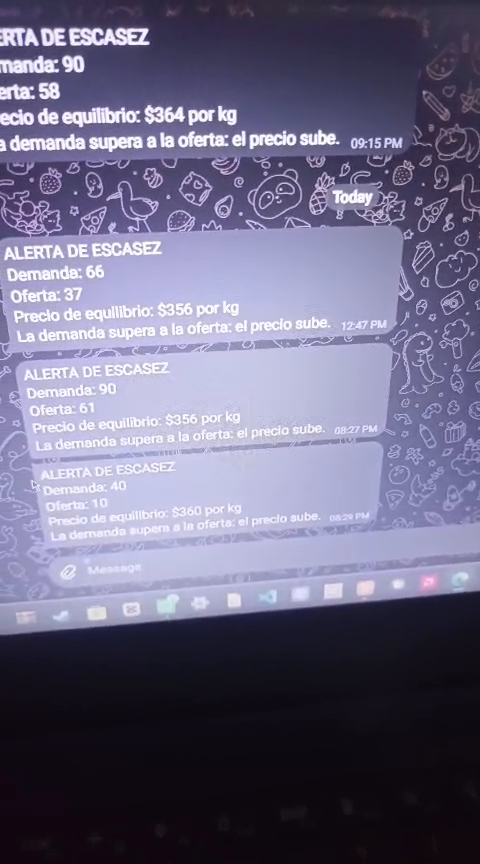

# Práctica 4.1 — Simulador de oferta y demanda

- **Alumno:** Cesar Jesus Gamez Mendoza
- **Materia:** Desarrollo Sustentable (ACD-0908)
- **Profesor:** Mtro. Miguel Ángel Barrón Hernández
- **Institución:** Tecnológico Nacional de México — Campus Mazatlán

## Descripción
Simulador físico de un mercado de camarón. Dos potenciómetros representan la **oferta** y la **demanda**; un Arduino UNO R4 WiFi calcula el precio de equilibrio con un modelo lineal y lo muestra en su matriz LED. Cuando la demanda supera a la oferta por 25 o más (escasez), el Arduino llama a un webhook de Make, que envía una **alerta por Telegram**.

**Flujo:** Potenciómetros → Arduino UNO R4 WiFi (calcula y muestra el precio) → Webhook de Make → Filtro (solo si hay escasez) → Telegram (alerta).

## Objetivo
Explicar cómo la oferta y la demanda fijan los precios, relacionar la escasez de un recurso natural con su precio y construir un sistema IoT que convierta un fenómeno económico en datos y alertas automáticas.

## Material utilizado
- Arduino UNO R4 WiFi con cable USB-C
- 2 potenciómetros de 10 kΩ, protoboard y cables jumper
- Computadora con Arduino IDE (biblioteca `Arduino_LED_Matrix`, incluida con la placa)
- Red Wi-Fi de 2.4 GHz
- Cuenta de Make y Telegram (bot creado con @BotFather)

## Conexiones
Los rieles del protoboard reparten la alimentación: **5V del Arduino al riel "+"** y **GND al riel "−"**.

| Potenciómetro | Pata izquierda | Pata central | Pata derecha |
|---|---|---|---|
| Demanda | Riel − (GND) | A0 | Riel + (5V) |
| Oferta | Riel − (GND) | A1 | Riel + (5V) |

Cables: rojo = 5V, negro = GND, amarillo = A0 (demanda), verde = A1 (oferta).

## Modelo económico
Los potenciómetros se leen con `analogRead` (0 a 1023) y se convierten con `map` a una escala de 10 a 90. Con `a = 100 + demanda` y `b = oferta − 50`, el precio de equilibrio es `((a − b) / 2) × 4` pesos por kilo. Hay **escasez** cuando `demanda − oferta ≥ 25`, y la alerta se envía solo al *entrar* en escasez y como máximo una vez por minuto. La explicación completa está en [`Codigo/Explicacion del blueprint.md`](Codigo/Explicacion%20del%20blueprint.md).

## Código
- [`Codigo/simulador_oferta_demanda.ino`](Codigo/simulador_oferta_demanda.ino): programa del Arduino (hay que poner el nombre y la clave de tu Wi-Fi antes de subirlo; no se incluyen en el repositorio).
- [`Codigo/blueprint.json`](Codigo/blueprint.json): escenario de Make exportado, con el filtro `Solo si hay escasez` (importable con *Import Blueprint*; falta elegir la conexión del bot y el Chat ID propio).
- [`Codigo/Explicacion del blueprint.md`](Codigo/Explicacion%20del%20blueprint.md): explicación del modelo, del código y del escenario.

> El token del bot y el Chat ID **no** se incluyen en este repositorio.

## Imágenes
**Escenario completo en Make** (webhook → filtro → Telegram):

**Circuito con protoboard (Tinkercad, UNO R3 solo como esquema):**

**Circuito armado con la matriz LED mostrando el precio:**

**Alertas de escasez recibidas en Telegram:**

## Video
Video de la práctica con la prueba en vivo (YouTube): https://youtu.be/5BxTLffiHBc

El enlace también está en [`Video/enlace.txt`](Video/enlace.txt).

## Resultados
[`Resultados/Resultados.pdf`](Resultados/Resultados.pdf): investigación previa, tabla de experimentos de mercado, respuestas a las preguntas y conclusión de lo aprendido en la práctica.

## Preguntas de reflexión

**1. ¿Por qué el precio sube cuando la oferta baja, aunque el producto sea el mismo?**

Porque el precio no depende solo del producto, sino de cuánto hay disponible frente a cuánta gente lo quiere. Si baja la oferta y la demanda se mantiene, hay más compradores que producto: unos están dispuestos a pagar más para no quedarse sin él y los vendedores pueden cobrar más. El precio sube hasta que algunos compradores desisten y la cantidad demandada vuelve a igualar a la ofrecida. Es lo que muestra el simulador: al bajar el potenciómetro de oferta, la diferencia con la demanda crece y el precio calculado aumenta, aunque el camarón sea exactamente el mismo.

**2. Una veda reduce la oferta y sube el precio. ¿Por qué aun así conviene para la economía de largo plazo?**

Porque protege el recurso del que depende la actividad. El camarón silvestre se reproduce y crece durante la veda; si se pescara todo el año, se capturarían ejemplares antes de reproducirse y las poblaciones podrían disminuir hasta que ya no hubiera suficiente para pescar. A corto plazo el precio sube y los pescadores y compradores pierden ingresos o pagan más, pero a largo plazo la veda mantiene la oferta futura, el empleo de la flota y de las plantas procesadoras, y evita la quiebra de un recurso común. Es un costo temporal que se paga para no perder el ingreso permanente.

**3. ¿Qué factores reales de la oferta de camarón no considera su modelo (clima, costos de combustible, importaciones)?**

El modelo solo usa dos números (oferta y demanda) y una fórmula lineal. No incluye el clima y los fenómenos como huracanes o la temperatura del mar que cambian la captura; el costo del combustible (diésel) y de otros insumos, que según pescadores de Mazatlán vuelve poco rentable salir a pescar; el camarón de granja, que compite con el silvestre y depende del agua, el alimento y enfermedades; las importaciones de camarón extranjero, que aumentan la oferta y bajan precios; los permisos y cuotas; los inventarios congelados, que amortiguan la veda; ni la competencia internacional y el tipo de cambio en las exportaciones. Tampoco incluye expectativas ni especulación, que también mueven el precio.

**4. ¿Qué ventaja tiene automatizar una alerta de escasez para un productor o una cooperativa?**

Le da información oportuna sin tener que revisar el mercado todo el tiempo. Una cooperativa que recibe un aviso cuando la demanda supera a la oferta puede decidir rápido: reservar producto, negociar un mejor precio, programar la venta o ajustar la producción en granjas. También ayuda a no vender barato antes de que suba el precio. La automatización con un webhook cuesta poco, funciona todo el día y reduce errores humanos; además, limitar a una alerta por minuto evita saturar el celular y gastar créditos de la plataforma.

**5. ¿El precio de mercado incluye el costo ambiental de producir el camarón? Explique.**

En general no. El precio refleja los costos que paga el productor (combustible, mano de obra, alimento, permisos) y lo que está dispuesto a pagar el consumidor, pero no incluye el daño que la actividad causa a otros: la pesca de arrastre captura fauna de acompañamiento y daña el fondo marino, y las granjas camaroneras pueden provocar pérdida de manglar y descargas de nutrientes a bahías y esteros. Esos costos los absorbe la sociedad y los ecosistemas, lo que es una externalidad negativa. Por eso el camarón puede parecer barato aunque tenga un costo ambiental alto. Se puede internalizar con vedas, cuotas, artes de pesca selectivas, certificaciones de pesca sostenible o impuestos ambientales que lo reflejen en el precio.

## Conclusión
El simulador muestra que el precio no es un número fijo, sino el resultado del equilibrio entre oferta y demanda: al mover los potenciómetros cambia el precio calculado y el sistema avisa cuando la demanda supera a la oferta. En la prueba en vivo la matriz mostró el precio y llegaron alertas a Telegram cada vez que se entró en escasez. También vi que un modelo simple deja fuera factores reales (clima, combustible, importaciones) y costos ambientales que el precio no incluye. Conectar el Arduino con Make y Telegram convirtió un fenómeno económico en un sistema de alertas automáticas útil para productores y cooperativas.
